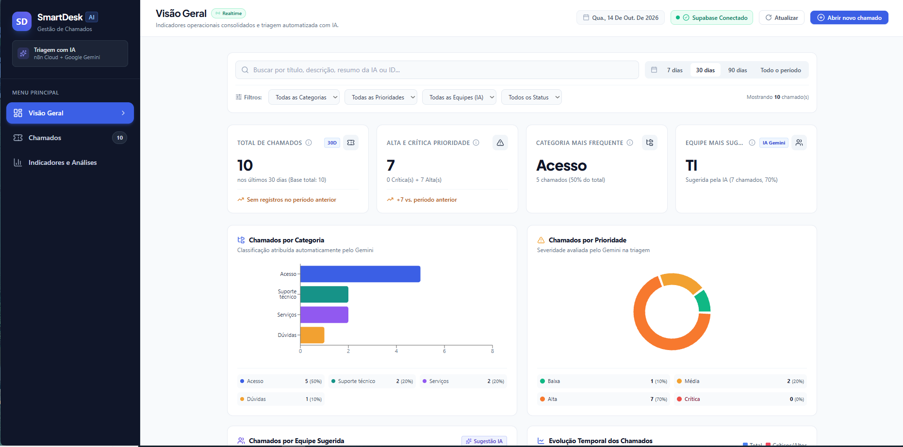
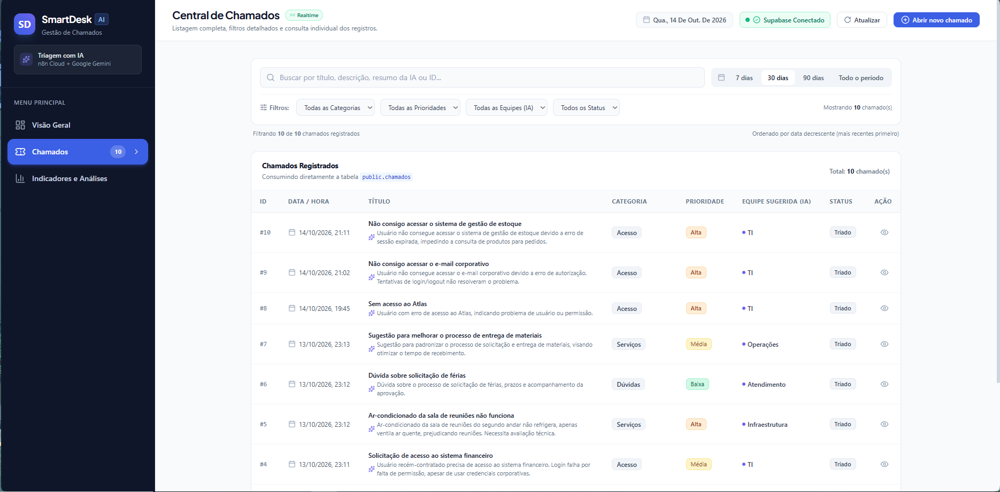
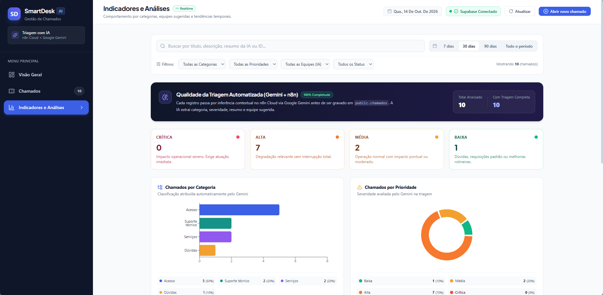
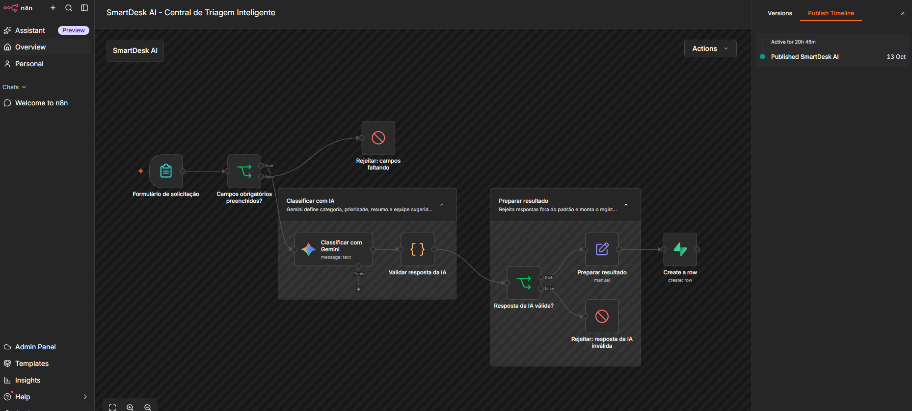

## 📸 Demonstração do Projeto

O **SmartDesk AI** é uma central inteligente de triagem de solicitações que utiliza inteligência artificial para classificar chamados, definir prioridades e sugerir equipes responsáveis, automatizando etapas do processo de atendimento.

### 🎥 Vídeo de demonstração

[▶️ **Assistir à demonstração completa no YouTube**](https://youtu.be/8HmBd0GEog4)

### 🖥️ Dashboard — Visão Geral

### 🎫 Central de Chamados

### 📊 Indicadores e Análises

### ⚙️ Fluxo de Automação

### 🛠️ Tecnologias utilizadas

- **n8n Cloud:** orquestração e automação do fluxo de triagem.
- **Google Gemini:** classificação inteligente dos chamados.
- **Supabase:** armazenamento e consulta dos dados.
- **Dashboard Web:** visualização de chamados e indicadores.

O fluxo recebe uma solicitação, utiliza IA para classificá-la e direcioná-la à equipe sugerida, armazena os dados no Supabase e permite acompanhar os resultados pelo dashboard.
